### Hi, I'm Abishek 👋

Software Engineering at McMaster University, based in Toronto. I mostly work on CI/CD, developer tooling, and backend systems, with side projects in graphics and audio.

#### Currently

- **Software Engineer Intern @ AMD** (May 2026 – present): CI/CD and developer tooling for Instinct GPU systems
- Building [**audio-visualizer**](https://github.com/abi2055/audio-visualizer), an audio visualizer from first principles
- Building [**job-finder**](https://github.com/abi2055/job-finder), a personally tailored internship and new-grad job finder

#### Previously

| Role | Company | When | Focus |
|---|---|---|---|
| AI/ML Software Developer Intern | RBC | Jan – Apr 2026 | FastAPI, LLM pipelines, SQL Server |
| Software Developer Intern | Telesat | Apr – Dec 2025 | GitLab CI/CD, Docker, Kubernetes, gRPC |
| Full Stack Software Developer Intern | A Round Entertainment | Apr – Sep 2024 | React, Node.js, Firebase |

#### Selected projects

| Project | What it is | Stack |
|---|---|---|
| [Ghost Writer](https://github.com/abi2055/magic-midi) | AI MIDI composition assistant | TypeScript, React, Gemini |
| [Fourth Wall Audio](https://github.com/abi2055/fourth-wall-audio) | Books turned into multi-voice audio scenes | Python, FastAPI, ElevenLabs |
| [Disco Lighting Renderer](https://github.com/abi2055/Disco-Amy) | Real-time lighting renderer | C++, OpenGL, GLSL |
| [Airline DBMS](https://github.com/abi2055/Airline-DBMS) | Airline operations database design | SQL, IBM DB2 |
| [Visual Web Agent](https://github.com/abi2055/visual-web-agent) | Vision-guided shopping agent | Python, YOLOv8, LangChain |

Stats card regenerates daily via GitHub Actions ([scripts/generate_stats.py](scripts/generate_stats.py)).
